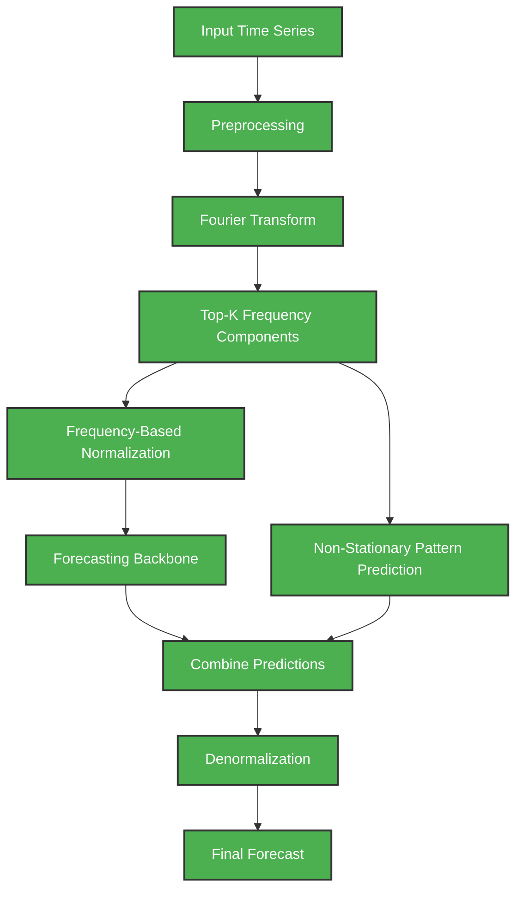

# 1. Project Title: Frequency Adaptive Normalization for Non-Stationary Time-Series Forecasting (FAN)

This project aims to implement and evaluate **Frequency Adaptive Normalization (FAN)**, a novel method designed to improve forecasting accuracy on non-stationary time-series data. By extracting dominant frequency components from the signal, FAN adaptively normalizes the data to better handle changing statistical properties over time. This repository contains the code for a phased reproduction and evaluation of the method.

---

## 2. Project Overview

Time-series forecasting involves predicting future values based on historical data. However, real-world data often exhibits **non-stationarity**, meaning its statistical properties like mean, variance, and periodicity change over time. These changing trends and shifting seasonality make it difficult for standard forecasting models to learn consistent patterns. 

**FAN** addresses this problem by moving beyond simple time-domain statistics. The high-level idea is to transform the time series into the frequency domain, perform frequency analysis to isolate the shifting patterns, apply an adaptive normalization tailored to those frequencies, and finally forecast the future values.

---

## 3. Research Paper

- **Paper Title:** Frequency Adaptive Normalization For Non-stationary Time Series Forecasting
- **Authors:** Weiwei Ye, Songgaojun Deng, Qiaosha Zou, Ning Gui
- **Year:** 2024
- **Venue:** NeurIPS 2024
- **Conference Category:** A*
- **Official Paper:** [NeurIPS Link](https://proceedings.neurips.cc/paper_files/paper/2024/file/37c6d0bc4d2917dcbea693b18504bd87-Paper-Conference.pdf)
- **Official GitHub:** [wayne155/FAN](https://github.com/wayne155/FAN)

---

## 4. Problem Statement

Traditional normalization methods typically rely on global or local statistics (like mean and variance) to stabilize data before feeding it to a model. However, these methods often fail to adequately capture and adjust for dynamic, changing seasonal or frequency-based patterns inherent in non-stationary time series. FAN proposes using frequency-domain information to actively identify and separate these important changing patterns, allowing for more robust and adaptable forecasting.

---

## 5. Research Gap / Motivation

- **Dynamic Patterns:** Time-series patterns change over time; what is periodic today might shift tomorrow.
- **Limitations of Basic Normalization:** Standard mean/variance-based normalization (e.g., standard scaling) may completely miss or distort changing frequency characteristics.
- **Rigid Frequency Methods:** Existing methods that use fixed or global frequency representations often fail to capture instance-wise frequency changes accurately.
- **The FAN Solution:** FAN directly addresses this by introducing an adaptive, frequency-based normalization technique that dynamically handles the non-stationary components.

---

## 6. Proposed Approach

At a high level, the complete FAN architecture operates as follows:

1. Input historical time series.
2. Frequency transformation using Fourier Transform (FFT).
3. Identify important (Top-K) frequency components.
4. Extract the non-stationary frequency information.
5. Normalize/remove the non-stationary component.
6. Forecast the stationary/residual component using a backbone model.
7. Predict the future non-stationary pattern independently.
8. Combine the forecasts.
9. Apply denormalization.
10. Produce the final prediction.


*(Note: All components of the architecture have now been successfully implemented.)*

---

## 7. Dataset

All 4 ETT-small datasets are downloaded and used for training, evaluation, and the interactive UI.

| File | Resolution | Rows |
|------|-----------|------|
| `ETTh1.csv` | Hourly (1h) | 17,420 |
| `ETTh2.csv` | Hourly (1h) | 17,420 |
| `ETTm1.csv` | 15-min | 69,680 |
| `ETTm2.csv` | 15-min | 69,680 |

- **Split:** 7/2/1 (Train/Val/Test) across all rows — following the official FAN paper approach.
- **Scaling:** Fitted strictly on the training split to avoid data leakage.
- **Modelled variables:** All 7 numeric channels are forecast jointly. The UI highlights OT (Oil Temperature).

**Official ETT Dataset Source:** [https://github.com/zhouhaoyi/ETDataset](https://github.com/zhouhaoyi/ETDataset)

See [`docs/DATASETS.md`](docs/DATASETS.md) for full details.

---

## 8. Evaluation Metrics

The final model performance is evaluated on every test sample and all seven normalized output channels using:

- **Mean Squared Error (MSE):** Measures the average squared difference between the estimated values and the actual value.
  $$ MSE = \frac{1}{n} \sum_{i=1}^{n} (Y_i - \hat{Y}_i)^2 $$
- **Mean Absolute Error (MAE):** Measures the average absolute magnitude of the errors in a set of predictions.
  $$ MAE = \frac{1}{n} \sum_{i=1}^{n} |Y_i - \hat{Y}_i| $$

*(Note: Final comparative numerical results and ablation studies are available in `docs/Final_Report.md`.)*

---

## 9. Project Phases

### Phase 1 — Understanding, Dataset & Frequency Analysis
**STATUS: COMPLETED / CURRENT IMPLEMENTATION**
- Study the FAN paper and understand the problem space.
- Understand Fourier Transform concepts.
- Set up the project environment.
- Load the ETTh1 dataset.
- Inspect dataset properties and check for missing values.
- Preprocess data (forward fill).
- Train/validation/test split (7/2/1).
- Training-only normalization/scaling to strictly avoid data leakage.
- Basic time-series visualization.
- Perform FFT analysis to identify dominant frequencies.
- Demonstrate Top-K frequency selection and perform inverse FFT reconstruction.
- Generate frequency spectrum plots.
- Create basic project documentation.
> **Note:** Phase 1 does NOT contain the complete FAN forecasting model.

### Phase 2 — FAN Core Implementation
**STATUS: COMPLETED / CURRENT IMPLEMENTATION**
- Implement the core FAN components based on the paper and official implementation:
  - Frequency-based normalization.
  - DFT/FFT processing block.
  - Top-K frequency component selection.
  - Reconstruction of non-stationary components.
  - Separation of the residual/stationary component.
  - Adaptive normalization and denormalization logic.
  - Non-stationary pattern prediction using MLP.

### Phase 3 — Forecasting Model Integration
**STATUS: COMPLETED / CURRENT IMPLEMENTATION**
- Integrate FAN with a chosen forecasting backbone.
- Develop a modular implementation where the FAN block can wrap any backbone.
- Data Flow: Input → FAN normalization → Forecasting backbone & FAN non-stationary prediction → Combine → Denormalization → Final prediction.

### Phase 4 — Baseline Models
**STATUS: COMPLETED / CURRENT IMPLEMENTATION**
- Implement suitable baseline forecasting models for comparison.
- The implemented comparison baseline is DLinear.

### Phase 5 — Training & Evaluation
**STATUS: COMPLETED / CURRENT IMPLEMENTATION**
- Train the baseline models and the FAN-based model.
- Evaluate using element-weighted MSE and MAE on all four datasets.
- Maintain consistent data splits, prediction horizons, preprocessing, and evaluation methodology across models.
- Save the best-validation checkpoints and machine-readable result files.

### Phase 6 — Experiments & Analysis
**STATUS: COMPLETED / CURRENT IMPLEMENTATION**
- **Dataset Comparison:** Compare performance across selected datasets.
- **Forecast Horizon Comparison:** Test 12, 24, 36, 48, 60, 72, 84, and 96 steps.
- **Frequency Analysis:** Study Top-K values 1, 3, 5, 10, and 20.
- **Ablation Study:** Compare the recorded Top-K configurations on ETTh1.

### Phase 7 — Visualization & Minimal Web UI
**STATUS: COMPLETED / CURRENT IMPLEMENTATION**
- Create a minimal UI for demonstration purposes (NOT the primary research contribution).
- The UI will allow users to:
  - Select/upload a time-series sample.
  - View historical values.
  - Run forecasting.
  - View predicted values and basic evaluation plots.

### Phase 8 — Final Analysis & Documentation
**STATUS: COMPLETED / CURRENT IMPLEMENTATION**
- Prepare final results tables (MSE/MAE comparisons).
- Generate visualizations of baseline vs. FAN comparisons.
- Document observations, limitations, conclusions, and potential future work.
- Clearly distinguish between our reproduced results and those originally reported in the FAN paper.

---

## 10. Team

- Meet Dhorajiya (202451053)
- Daksh Amalseda (202451012)
- Keval Chorada (202451089)

The repository records the workstreams—data/frequency analysis, FAN integration, and baselines/evaluation/UI—but does not contain reliable per-person commit history or a name-to-workstream mapping. Individual contribution claims should therefore be added only after confirmation by the team.

---

## 11. Technology Stack

- Python
- PyTorch
- NumPy
- Pandas
- Scikit-learn
- Matplotlib
- Google Colab / Kaggle
- Git / GitHub

---

## 12. Reproduce and Verify

```powershell
# Full training: 4 datasets x 8 horizons x 2 models
python scripts/train_all.py

# Reload every checkpoint, evaluate complete test splits, and create figures
python scripts/evaluate_all.py

# Top-K ablation
python scripts/run_ablation.py

# Automated checks
python -m unittest discover -s tests -v

# Interactive demo
python app.py
```

Results are written to `outputs/results/`, report figures to `outputs/figures/`, and checkpoints to `outputs/models/`.
